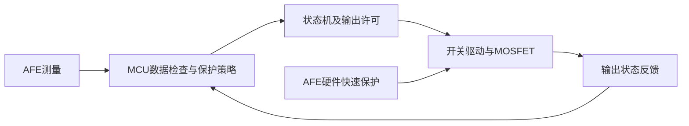

# 学习笔记：原型与实际BMS的关系

日期：2026-10-16。用途：说明当前软件骨架与实际电池管理设计的对应关系，供复盘和面试准备。本文没有新增项目功能，也没有改变已确定的硬件采购方向。

## 核心流程相通

对于采用MCU的电池管理系统，可以按“取得测量→判断数据是否可靠→保护决策→状态转换→输出控制及反馈”理解控制主线。这是结合本项目和厂商架构作出的概括，具体模块、调度周期和状态划分由产品决定，不是全行业统一的软件模板。

当前Bms_ControllerStep()已经把正常保护、活动故障、恢复许可和状态机连接起来，体现了保护优先、独立时间戳、故障累计、恢复回差、稳定时间和命令门控。十组电脑测试及Keil构建通过；load_enabled仍只是软件许可，尚未驱动或验证真实负载。

## 重要差别一：硬件保护与软件管理并行

计划中的BQ76920本身带过压、欠压、放电过流和放电短路等硬件保护，以及对主控的告警接口；主控通过I²C访问测量值并实现管理功能。因此后续接入AFE时，既要读取测量，也要处理其保护状态和告警。[TI BQ76920](https://www.ti.com/product/BQ76920)

以AFE＋MCU＋MOSFET电池包为例，可按如下关系理解；该图是结构解释，具体接线必须依据所选模块原理图：

软件周期检查不能替代快速短路保护。反过来，硬件保护被触发后，主控也不能仅因软件许可变为1就强行绕过它。项目后续需验证软件请求、AFE保护状态和实际输出之间的关系。

也存在无需MCU控制即可完成保护与均衡的专用器件，例如BQ77915。因此不能把“所有电池保护板都运行这四状态机或FreeRTOS”当作事实。[TI BQ77915](https://www.ti.com/product/BQ77915)

## 重要差别二：故障动作及恢复策略按类型设计

当前原型把检查发现的故障统一锁定，满足恢复条件后通过CLEAR回到待机，再发START运行。这样方便验证优先级与清除行为，是本项目的明确策略。

实际器件可以分别控制充电和放电开关，并为不同保护设置恢复行为。例如BQ76952支持可配置保护、可选自主恢复及不同低功耗模式，其技术手册还区分主要保护与永久故障。[TI BQ76952](https://www.ti.com/product/BQ76952)、[BQ76952技术参考手册](https://www.ti.com/document-viewer/lit/html/SLUUBY2)

据此，设计产品时需要逐项回答：故障禁止充电还是放电、是否需要锁定、能否自动恢复、需要何种外部条件。不能把本项目的统一CLEAR方式当作所有BMS的固定规则；当前软件参数与2秒恢复时间也不是通用电池参数。

## 重要差别三：高压车载系统增加高压控制及诊断

NXP高压BMS参考平台区分电芯监测单元CMU、管理单元BMU和电池接线盒BJB；BJB包含电流、包级高压及电池对车身绝缘监测。其BMU参考板还具有接触器驱动、预充控制接口、热管理输出、互锁及唤醒功能。[NXP高压BMS架构指南](https://www.nxp.com/document/guide/high-voltage-bms-reference-designs:GS-RD-HVBMSCTBUN)、[NXP RD-K344BMU](https://www.nxp.com/design/design-center/development-boards-and-designs/RD-K344BMU)

这些是高压系统的扩展例子，不代表小型低压电池包都必须采用同样架构。状态机可增加或分解预充、充电、休眠、唤醒等状态；具体是一个状态机还是多个协作状态机，要按系统职责设计。

例如在高压产品中，进入允许运行之前，还要按设计完成预充和相关反馈确认。软件置位允许输出与实际接触器已经正确动作是两件事，需通过测量和诊断确认。

## 当前求职项目的定位

目前完成的是电池监测与保护控制的软件骨架和电脑测试。还需通过实际外设、采样有效性、负载控制、通信、任务调度及故障注入来补齐演示闭环；SOC、均衡、Bootloader等仍按既定计划放在后续。

面试时可据实描述：“实现了采样数据格式、保护与故障汇总、四状态机、恢复回差与稳定计时，并用模拟采样完成控制链测试。”目前应同时说明“真实采样与负载控制尚未上板验证”。

本次资料中的BQ76952、BQ77915和NXP平台仅作架构说明，不构成新采购建议，也不表示修改STM32F103＋BQ76920的既定项目方向。
