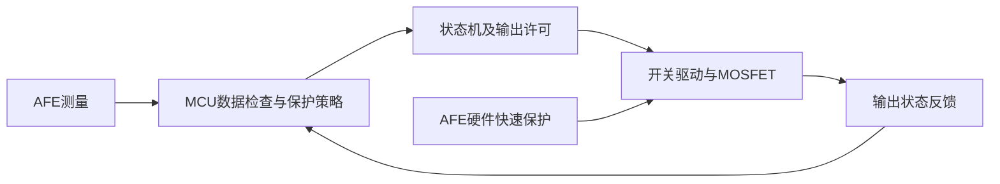

# 学习笔记与参考资料

更新：2026-10-31。这里只保存原理理解、资料用途和版本，不替代当前操作或实测记录。手册 PDF 继续留在被 Git 忽略的 /手册/；本文件可以提交到仓库。

<a id="qt-business-20261031"></a>

## Qt首版：上报、指令和会话分别如何流动

2026-10-31，以317d2e7为当前源码。Qt主要功能已实现并获基本成功反馈，本节解释实现，不扩展新功能或将未测场景标为完成。

### 两端分工

MCU负责采样、数据时效、保护状态机和MOS输出。Qt负责观察报告、提交人工操作、显示历史与保存PC记录。Qt断开不应停止MCU本地保护。Qt当前通过UART通信，MCU另有经典CAN；Qt直连CAN和Linux网关尚未实现。

### 文件各自负责什么

| 文件或对象 | 职责 |
| --- | --- |
| main.cpp | 创建应用和窗口，进入事件循环 |
| mainwindow.ui | 描述控件、布局和提升控件 |
| MainWindow | 串口会话、事件协调、显示和命令等待状态 |
| BmsLineBuffer | 将任意分块的串口字节整理成完整行，限制1024字节残行 |
| ParseBmsLog / BmsLogRecord | 校验字段并生成统一数据对象 |
| bms_commands | 命令许可与目标状态判据 |
| BmsCsvLogger | 开始、追加、停止文件记录及错误处理 |
| BmsTrendHistory / BmsTrendWidget | 有限历史、分段数据和自定义绘图 |

这属于按职责拆分的具体结构，没有实现完整MVC、通用消息总线或Qt业务多线程。

### 事件循环与信号槽

main中的QApplication::exec进入事件循环。按钮、串口和定时器触发对应处理函数。构造函数里的connect建立对象信号与处理函数的关系，不是打开COM口；实际串口打开在toggleConnection内的m_serial.open。

当前业务对象在主线程中处理事件，没有为串口、CSV和趋势分别创建任务。常规回调依次执行；接收不需要阻塞等待，但回调中的耗时工作仍会延迟界面响应。CSV write/flush目前就是同步文件操作。QTimer的200ms为检查间隔配置，不是实时响应保证。

来源：[Qt事件循环](https://doc.qt.io/qt-6/qcoreapplication.html#exec)、[Qt信号与槽](https://doc.qt.io/qt-6.12/signalsandslots.html)。

### 一条上报的路径

~~~text
MCU UART字节
  -> QSerialPort的readyRead -> readAll
  -> BmsLineBuffer::append整理完整行
  -> 原始日志显示
  -> ParseBmsLog校验成功 -> BmsLogRecord
       -> 更新m_latestReport、m_haveReport和最后接收计时
       -> showTelemetry显示数值/状态
       -> checkCommandResult观察指令目标
       -> updateCommandButtons刷新许可
       -> appendRecording保存CSV（正在记录时）
       -> trendWidget->addRecord保存历史并请求重绘
~~~

串口一次读取可能是不完整的一行，也可能有多行；不能把一次readyRead当成一条报告。换行前的残留保存在m_pending，超长行丢弃到换行，重连时清除旧残行。

解析器按字段名取值，拒绝缺字段、重复键、非数值和范围错误；先填局部next，整行通过后才result=next。解析失败不会把半新半旧的字段写到调用方，也不刷新接收有效期。此处是对象整体赋值策略，不宣称多线程原子性。

说明示例：假设某次已校验记录为cellMv=3500、temperatureDc=268、currentMa=50，显示对应3.500V、26.8℃和50mA，CSV仍保留3500、268、50。示例不是本轮新增实测。

### 三种不同的有效性

1. 报文格式是否正确：ParseBmsLog返回值。
2. PC是否持续收到报告：m_lastReport经过时间，小于1000ms才算新鲜。
3. MCU测量是否有效：电流要求iv=1、i_age<500ms、i_src=3。报告持续发送时，内部采样仍可能失效。

电流0mA可以是有效测量，不能作为通信失败标志。自检或活动故障的0xE0采样错误位存在时，电压/温度采用保守隐藏；过压等保护故障本身不一定意味着数值不可信。CSV保留无效值及标志用于排查，趋势对无效点留缺口，不补零。

### 指令的路径与边界

~~~text
点击Start/Stop/Clear
  -> sendCommand再次检查许可
  -> write单字节S/T/C
  -> 本机记录待观察命令并启动计时
  -> MCU本地判断与执行
  -> 后续报告
  -> BmsCommandTargetObserved判断目标状态
~~~

START需要新鲜健康待机报告且没有其他待观察命令；CLEAR需要新鲜故障锁定、当前无活动故障及MCU上报clearAllowed。STOP只要求串口打开，允许覆盖本机先前等待项；这不是取消已发送字节，也不保证传输无延迟。

write接收字节只说明本地串口接口接收了写入。当前没有命令ID和ACK，后续目标状态匹配只能称“观察到目标状态”，不能证明该条指令的严格因果应答或MOS实际动作。2秒未观察到、1秒无新报告或断线时提示未确认，不自动重发。

### 不要混合的状态

| 状态 | 保存位置 | 说明 |
| --- | --- | --- |
| 端口是否打开 | m_serial.isOpen | 打开不等于MCU活着 |
| 是否有新鲜报告 | m_haveReport / m_lastReport | 决定是否能根据旧信息发起操作 |
| MCU业务状态与故障 | m_latestReport | MCU上报的自检、待机、运行、故障锁定 |
| 指令是否等待观察 | m_pendingCommand / m_commandWait | Qt本机的交互过程 |
| CSV是否记录 | m_csvLogger | 文件会话，与MCU运行状态独立 |
| 趋势历史/通道 | BmsTrendWidget | 显示会话与选项 |

updateCommandButtons只刷新按钮许可；updateConnectionUi在连接变化时清理旧报告、残行、待观察状态和趋势。此前把reset放进按钮更新函数，会在每次接收和定时检查时清历史，正是两类职责混在一起产生的错误。

### C++学习点落在什么位置

| 语法或机制 | 本项目例子 | 理解重点 |
| --- | --- | --- |
| struct与值拷贝 | BmsLogRecord，m_latestReport=record | 一份校验后的记录供多个模块使用 |
| class与private | BmsLineBuffer、BmsCsvLogger | 模块管理自己的缓存或文件状态 |
| const引用参数 | const BmsLogRecord &record | 避免参数拷贝且禁止函数通过该引用修改记录 |
| 输出引用 | ParseBmsLog(..., BmsLogRecord &result) | 校验成功后把结果交给调用方 |
| 构造与析构 | MainWindow、BmsCsvLogger | 初始化资源、退出时释放；不保证异常断电持久化 |
| lambda | [this]() { sendCommand(...); } | 捕获当前对象指针，绑定按钮对应命令 |
| enum class | BmsCommand | 用具名命令代替到处散落的字符 |
| std::deque | BmsTrendHistory | 尾部添加新样本，头部移除过期样本 |

QObject的父对象负责销毁其子对象；C++值成员则随所属对象自动析构，两种所有权要区分。当前m_serial和m_csvLogger为值成员；ui辅助对象由delete ui释放，界面控件按Qt父子关系管理。来源：[QObject对象树与所有权](https://doc.qt.io/qt-6/qobject.html#Object-Trees-and-Ownership)。

### 当前阅读与核对练习

先打开main.cpp，再看MainWindow构造函数、readSerialData、BmsLineBuffer::append、ParseBmsLog。能说清“字节块→完整行→校验对象→多个使用者”以后，再逐行看指令等待和析构资源，不要求本轮添加新代码。

台架可核对：选一条实际完整上报，将cell0_mv、temp_est_dC、i_ma分别与面板单位和CSV原单位对应；检查iv=0的格式正确报告为何仍能记录、却不显示为有效电流。这里只给练习，不提前记为测试通过。

## 2026-10-29模块迁移：目录、任务和接口分别解决什么

拆文件不会自动增加FreeRTOS任务。当前仍是采集、保护、通信、心跳四个任务；同一个任务可以顺序调用多个模块，例如采集任务调用板级ADC、NTC换算和INA226。目录区分职责，任务区分调度上下文，二者不需要一一对应。

BSP保存板子特有的通道、引脚和有效电平；器件驱动理解INA226寄存器；业务组件理解保护规则和状态；APP把它们组合起来。Components/Bms、Sensing和Protocol不依赖HAL/RTOS，因此可以直接使用GCC在电脑运行测试。INA226仍使用HAL总线句柄，属于本项目的器件模块，不宣称能原样运行于任意芯片。

模块的static变量只允许本文件代码访问其符号；需要跨模块的数据通过函数复制。报告中的BmsStatus是公开结果，不包含控制器内部的恢复计时状态。快照队列按值复制多个字段，volatile只用于调试量/简单标志，不能代替多字段一致性。

本轮bms_ipc封装任务/ISR投递和STOP优先规则，是具体系统适配边界，尚未实现完整OSAL。HAL回调位于Core中，但只转发到板级接收模块，串口中断最终只投递短命令；保护和MOS动作在保护任务执行。

后文原理教程按历史日期保留；最新源码位置、已完成范围与板测状态以README和本轮测试记录为准。

<a id="ina226-protocol-20261026"></a>

## INA226与硬件I²C接入要点

本轮是候选实现，板测仍待完成，[教程与验收](开发步骤.md#ina226-i2c-20261026)。STM32的I²C1使用PB6/PB7，板载EEPROM与INA226共用SCL/SDA但使用不同地址。模块3.3 V供电让上拉保持3.3 V，SCL/SDA由开漏输出和上拉共同形成电平，不用推挽输出直接驱动总线。

INA226的寄存器指针是8位，而数据是16位。HAL_I2C_Mem_Read传入I2C_MEMADD_SIZE_8BIT和Size=2，通常完成写寄存器指针、重复起始、读高低两字节；HAL设备地址传7位地址左移1位，读写位由HAL处理。芯片高字节在前，现有CAN数值低字节在前，打包方式需分别处理。

本版根据分流电压I=U/R算电流，没有读取依赖Calibration寄存器的Current字段。每码2.5 µV，R100即0.1 Ω时每码25 µA；传入现有快照/CAN时舍入到整数mA，不能把原始量化步进说成测量准确度。CVRF新转换标志与有效位、采样新鲜度分别管理：读旧值并不刷新时间，返回无新数据可保留旧记录，通信失败置无效。[TI官方数据手册](https://www.ti.com/lit/ds/symlink/ina226.pdf)

数字来源EXTERNAL=3与旧AFE名字兼容，不意味着已经使用BQ76920。VBS是负载供电正端对地采样，不是逻辑VCC，也不是某节电池电压；低边MOS断开后正端仍可保持5 V，负载是否断电应测电阻两端。IN-是分流电阻负载侧，不能按名称误接电源负极。

<a id="freertos-basics-20261025"></a>

## 首次FreeRTOS迁移涉及的概念

2026-10-26用户已完成[业务与心跳两任务迁移](开发步骤.md#freertos-business-migration-20261026)，完整构建及基本上板回归成功；[命令队列方案](开发步骤.md#freertos-first-migration-20261025)尚未实施。任务是带独立调用栈的常驻执行流程；单核STM32在不同任务间切换，并不是同时执行多段C代码。osDelay使当前任务暂时阻塞，调度器可运行其它就绪任务；HAL_Delay和本轮UART轮询发送仍占用执行时间。

本地CubeF1 1.8.7实际内核task.h为FreeRTOS V10.3.1。CMSIS_V1用于生成任务入口，原生FreeRTOS队列用于值拷贝的命令传递；两者指向同一个内核。这里ST的cmsis_os.c将stacksize直接交给xTaskCreate，所以配置1024是1024 words，在CM3上为4096字节；不能把通用CMSIS文档的字节注释直接套到这份实现。栈水位uxTaskGetStackHighWaterMark也按word返回，表示运行以来最少未使用栈空间，不是当前调用栈深度。heap_4的16 KiB池与startup里C库堆0x200分开管理。

FreeRTOS任务优先级数值越大越优先；Cortex-M中断优先级数值越小越优先，这两套数值不能混用。调用FromISR的USART1从原0改为5，配合configLIBRARY_MAX_SYSCALL_INTERRUPT_PRIORITY=5；高于此逻辑优先级的中断不能调用这些内核接口。[官方Cortex-M规则](https://www.freertos.org/Documentation/02-Kernel/03-Supported-devices/04-Demos/ARM-Cortex/RTOS-Cortex-M3-M4)

后续队列方案：任务内调用xQueueSend，中断内调用xQueueSendFromISR；队列拷贝sizeof(BmsCommand)字节，传局部command的地址是为了读取其值，并不在队列中保留该局部指针。非阻塞入队满时返回失败，需要明确处理。普通FIFO不自动赋予STOP更高优先级，计划另用停止标志，并由控制处理取消积压命令。当前源码仍为单槽入口；STOP仍需等控制任务执行，不等于硬件立即切断。

HAL_GetTick继续用TIM4维护毫秒计数，RTOS tick由SysTick维护调度；两者本轮都配置1 ms，但不是同一个计数器。采样时间戳、500 ms有效期和2 s恢复稳定时间继续使用HAL_GetTick，暂不混入RTOS tick。

第一轮两个任务只有业务任务访问采样/控制器、ADC、CAN和日志，心跳任务仅控制D3，所以没有共享外设互斥需求。后续拆开任务时需要快照交付或锁，volatile本身不保证多字段一致性。D3正常闪烁也不能单独证明业务任务活着；IWDG活性监督属于后续。

导航：[手册索引与阅读顺序](#r11) · [CAN模块资料](#can-reference-20261023) · [BQ76920自制板资料](#afe-reference-20261022) · [原型与实际 BMS](#r19) · [Cortex-M3 寄存器](#r25) · [CubeMX用户代码区](#cubemx-user-code) · [电源CV/CC与OCP](#power-cv-cc-ocp)。参考仓库与硬件选型约束另见[项目规划](项目规划.md#p01)。原有PDF保持原样，2026-10-22从TI下载4份AFE资料，2026-10-23用户提供2份CAN模块PDF及2个参考ZIP。

<a id="r11"></a>

## 手册索引与阅读顺序

首次整理：2026-10-15，从官方手册资料目录13份PDF中选取9份，约41.8 MiB。2026-10-17补入双USB核心板原理图，当时共10份、约42.26 MiB，复制件与来源SHA-256一致。2026-10-22补入4份TI AFE资料，当时共14份、50,273,776字节；2026-10-23用户新增两份CAN PDF后，当前共16份、51,773,872字节（约49.38 MiB，不含ZIP）。新增CAN PDF验证可解析页数并查看操作页/原理图，原文件未修改。

本页保存文件名、用途与版本信息，可随项目提交。PDF及本地阅读说明保存在被忽略的“手册”目录中，GitHub不包含这些文件；更换电脑后从原资料包及本文记录的TI链接重新准备。

### 来源与存放位置

来源：

```text
D:\嵌入式学习\野火STM32F103ZET6核心板双USB款\野火STM32F103ZET6核心板双USB款_20240727\1-硬件资料_参考资料_规格手册\参考资料\STM32F1官方手册资料
```

新增原理图来源为同一资料包的“1-硬件资料_参考资料_规格手册/原理图_尺寸图_封装库_IO表格”，不属于上面的13份官方手册目录。

项目内存放方式：

```text
手册/
├─ README.md
├─ 01_芯片与板卡/       6 份 PDF
├─ 02_内核与实时系统/   3 份 PDF
├─ 03_定时器/           1 份 PDF
├─ 04_BQ76920/          4 份 PDF
└─ CAN/                2 份 PDF、2 个参考 ZIP
```

原STM32资料的链接在手册/README.md，文件名和正文保持原样；新增AFE资料的文件名与来源见下节，下载后未修改PDF内容。

<a id="can-reference-20261023"></a>

### 用户提供的USB-CAN模块资料

2026-10-23用户放入手册/CAN/，作为该供货方模块的参考资料；不把供货方说明等同于PEAK原厂文件。所有文件仍由/手册/忽略，后续代码自行实现，不把ZIP源码直接加入本项目。

| 本地文件 | 版本/页数或内容 | 本项目用途 |
| --- | --- | --- |
| USB TO CAN 调试器模块使用说明书.pdf | V1.0，12页 | 第3页XCAN/PCAN枚举名称、第5～6页驱动、第7～8页PCAN-View、第10～12页双设备示例 |
| USB TO CAN 调试器模块原理图.pdf | 1页，图中无明确版本日期 | 非隔离USB/CAN参考地、120 Ω与开关、CANH/L及下载接口定义 |
| 固件和源码（参考）/1-固件烧录工具.zip | DFU工具及说明 | 后续理解固件维护；本轮仅列目录，未运行安装器 |
| 固件和源码（参考）/2-固件和源码.zip | 含candleLight等固件/源码 | 后续对比协议；本轮仅列目录，未解包执行或刷入 |

使用说明第7页和参考原理图已渲染查看。说明中的PCAN驱动例子为4.4.2，而本机现已加载5.0.0.20000且状态正常，不因旧截图重复安装。参考图主控标STM32F072，先前模块照片为APM32F072，读取时保留版本差异；USB-CAN内部CAN_TX/RX引脚不是现有F103核心板的引脚分配。

第3页说明中的“至少一个120R”属于简化描述，本项目仍按两端各120 Ω配置并做断电约60 Ω检查。第9页Linux示例存在bitrate/can0文字拼写问题，未来采用SocketCAN时按对应文档核对，不原样复制。工具/源码里的烧录步骤不作为本次驱动安装或CAN收发的前置动作。

新的[外部状态帧步骤](开发步骤.md#can-normal-status-20261023)沿用本机HAL CAN接口：控制器生成帧、收发器转换物理电平、PCAN-USB完成电脑接口。正常ACK是协议应答位，和MCU读取到一帧应用数据不同。

外部状态上报已在2026-10-23获用户基本成功反馈。下一步下行请求拟定标准数据帧0x201、DLC=1，01/02分别请求START/STOP；0x301仍为周期状态上报。该约定属于本项目，当前源码尚未解析命令。合法格式、已提交请求、状态机允许执行是三个不同层次，CAN ACK只反映协议层正确接收，不能代替后两层结果。

UART中断与CAN主循环共享单槽时，需要统一投递和取走入口；短临界区保护槽更新，未处理STOP优先保留。单槽其余请求仍可能覆盖，不能称为消息队列。正式仲裁、消息应答与FreeRTOS有界队列后续设计；[新教程](开发步骤.md#can-start-stop-20261023)先验证手动低频命令及错误帧。

<a id="afe-reference-20261022"></a>

### 新增BQ76920自制子板资料

2026-10-22从TI官网获取，全部位于手册/04_BQ76920/且被Git忽略。记录的是本次实际下载版本，不自动代表以后官网版本不变。

| 本地文件 | 文档号/版本与页数 | 用途与官方来源 |
| --- | --- | --- |
| bq76920_datasheet_revI.pdf | SLUSBK2I，Rev I，67页 | 完整料号、引脚、电气范围、三串配置、典型电路与布局；[TI数据手册](https://www.ti.com/lit/ds/symlink/bq76920.pdf) |
| bq76920_evm_slvu924d.pdf | SLVU924D，Rev D，46页 | 参考AFE原理图、元件和模拟电芯方法；[TI EVM手册](https://www.ti.com/lit/ug/slvu924d/slvu924d.pdf) |
| bq769x0_design_considerations_slua749a.pdf | SLUA749A，Rev A，25页 | 电源、启动、滤波、保护与布局注意点；[TI设计考虑](https://www.ti.com/lit/pdf/SLUA749) |
| bq769x0_faq_sluub41a.pdf | SLUUB41A，Rev A，25页 | 接口、地回路、采样及常见问题；[TI AFE FAQ](https://www.ti.com/lit/pdf/SLUUB41) |

首轮先读数据手册第3页的型号表/引脚图、第39～40页表9-2的三串配置、第41页典型应用和第47页布局要求；EVM手册第40页图29为AFE原理图。初次按模块阅读，不要求一次通读。已查看上述型号表与典型电路，以及EVM图29；它们是参考，不代表自制电路已完成审阅。

数据手册区分BQ7692000PWR（2.5 V、无CRC）与候选BQ7692003PWR（3.3 V、CRC启用），后者7位I²C地址为0x08。封装同为20脚TSSOP也不能省略后缀核对，CRC与地址不能根据非官方旧示例猜测。

三串对应VC1–VC0、VC2–VC1、VC5–VC4三组有效差分输入，中间未使用通道按表9-2短接；正式连接和RC位置将在原理图步骤逐项确定。手册第39页表9-1还规定未使用SRP/SRN连接VSS、CHG/DSG可悬空。CHG/DSG是FET驱动端，不能当作普通3.3 V GPIO接口使用。

原理图符号表达电气连接，PCB封装决定焊盘和机械尺寸，两者需要逐脚对应。库里找到相同名称仅是起点；电路规则检查也不能证明参考电压、芯片版本、启动顺序或地回路设计正确。RevA的具体范围与操作见[项目规划](项目规划.md#afe-self-design-20261022)和[首个设计步骤](开发步骤.md#afe-project-start-20261022)。

### 已复制的资料

版本信息取自 PDF 封面或说明页，页数指 PDF 文件的实际页数，不等同于正文印刷页码。

| 本地分类 | 文件名 | 页数 | 本地版本 | 项目用途 |
| --- | --- | --- | --- | --- |
| 01_芯片与板卡 | `[野火]STM32F103ZET6核心板_双USB款_规格书V1.0.1.pdf` | 13 | V1.0.1，2024-06 | 优先看：板上供电、两种 USB 接口、SWD、LED 和 BOOT 跳帽 |
| 01_芯片与板卡 | `[野火]STM32F103ZET6核心板双USB款原理图.pdf` | 7 | 各页版本不同；LED所在第6页为V2.0、2023-11-04 | 核对LED有效电平、限流电阻、USB、跳帽及板载器件连接 |
| 01_芯片与板卡 | `2-STM32F103xCDE_数据手册-中文.pdf` | 87 | 对应英文 Rev 5，2009-03 | 核对 F103xE 的资源、LQFP144 引脚和电气条件，中文辅助阅读 |
| 01_芯片与板卡 | `2-STM32F103xCDE_数据手册-英文.pdf` | 123 | Doc ID 14611 Rev 7，2009-09 | 匹配 F103ZE 系列的数据手册，对照英文引脚与参数 |
| 01_芯片与板卡 | `1-STM32F10x-中文参考手册.pdf` | 754 | RM0008 中文译本，对应英文 Rev 10 | 学习 RCC、GPIO、EXTI、USART、ADC、DMA、I²C、CAN、定时器和看门狗 |
| 01_芯片与板卡 | `1-STM32F10x-英文参考手册.pdf` | 1128 | RM0008 Rev 15，2014-06 | 核对外设工作流程、寄存器位和限制，与中文版对照 |
| 02_内核与实时系统 | `STM32F10xxx Cortex-M3编程手册-英文版-PM0056-Rev6.pdf` | 156 | PM0056 Rev 6，2017-12 | 中断、异常、NVIC、SysTick、栈与内核寄存器；用于理解 FreeRTOS |
| 02_内核与实时系统 | `Cortex-M for Beginners - 2017_CN_v3.pdf` | 26 | Arm 入门白皮书，2017-03 | 快速建立 Cortex-M 家族、内核和 MCU 的概念 |
| 02_内核与实时系统 | `CM3权威指南CnR2.pdf` | 322 | 中文讲解资料；封面未标明对应的 ST 文档版本 | 按需理解 Cortex-M3、中断和异常流程，以官方手册核对细节 |
| 03_定时器 | `DM00042534_ZHV2_定时器应用笔记.pdf` | 33 | AN4013 中文第 2 版，2012-10 | 定时器时钟、时基、周期事件、PWM 和同步；只使用适用 F103ZE 的内容 |

野火规格书的 PDF 属性标题与实际封面不一致，本次以实际封面、正文和型号判断，没有修改其元数据。数据手册英文副本的属性也带有第三方站点名称，因此不能仅凭 PDF 属性认定来源版本。

### 本次暂不复制的资料

| 文件 | 原因 |
| --- | --- |
| 3-STM32F103x8数据手册.pdf | 对应 F103x8/xB，和项目 F103ZET6 的资源及封装选项不同 |
| STM8和STM32产品选型手册.pdf | 用于跨产品选型，当前型号已确定 |
| STM32F10xxx闪存编程参考手册.pdf | 本地为旧 PM0042 译本；第一版没有 IAP 或自定义 Bootloader，后续再查适配型号的 Flash 手册 |
| STM32系统存储器启动模式.pdf | AN2606 主要用于芯片系统 ROM 自举下载；当前先走 SWD，后续需要时再查 |

来源中的“更多官方文档下载方式.txt”仅为下载入口说明，本次也未复制。

### 按实施阶段查阅

| 阶段 | 优先资料 | 需要解决的问题 |
| --- | --- | --- |
| 初次上电与下载 | 野火规格书、数据手册 | 供电、两种 USB 接口、SWD、BOOT 跳帽、目标封装 |
| GPIO、UART、中断 | 野火双USB原理图；RM0008的RCC、GPIO/AFIO、USART、EXTI；PM0056的NVIC | 时钟、复用、串口收发与中断流程 |
| ADC 与 DMA | 数据手册、RM0008 的 ADC/DMA/RCC | 模拟输入引脚、参考电压、采样时钟、转换与搬运 |
| 定时采样 | RM0008 定时器章节、AN4013 | 时钟来源、分频、重装载、触发与周期 |
| I²C 与 CAN | RM0008 的 I²C、bxCAN | 地址、时序、收发、过滤器与中断 |
| FreeRTOS | PM0056，配合后续 FreeRTOS 文档 | 中断优先级、异常、SysTick、栈和上下文 |
| 看门狗与故障处理 | RM0008 的 IWDG、复位相关章节 | 超时复位与启动后的状态处理 |

不用从第一页通读所有资料。每一步围绕实际问题找章节、结合代码验证，并记录实际结果。

### 版本与适用性

本地中文 RM0008 对应英文 Rev 10，英文副本是 Rev 15；本地中文数据手册对应 Rev 5，英文副本为 Doc ID 14611 Rev 7。中英文不是同一版本，章节和页码可能不同。

核对时发现 [ST 当前 RM0008 英文文档](https://www.st.com/resource/en/reference_manual/cd00171190-stm32f101-103-105-107-stm32f100-series-armbased-32bit-mcus-stmicroelectronics.pdf) 为 Rev 21。本地资料作为学习副本保留；实际电气参数、工作条件及寄存器细节应结合目标芯片与官网对应资料核对，本次未额外下载或替换这些 PDF。

[STM32F103 官方文档目录](https://www.st.com/en/microcontrollers-microprocessors/stm32f103/documentation.html) 列有大容量器件的数据手册 DS5792，以及适用 STM32F101xC/D/E、STM32F103xC/D/E 的勘误 ES0340。当前来源目录没有这份勘误，后续外设验证时再结合实际芯片修订号核对；不能把中容量器件的 ES096 直接用于本项目。

RM0008 与 AN4013 覆盖多个系列或容量等级，不是其中每一个外设、通道和功能都属于 F103ZE。野火规格书对应双 USB 款 V1.0.1，收到硬件后仍需核对实物 PCB 和接线。上述是资料适用性说明，不是已经发生或解决的上板故障。

2026-10-17串口基础准备使用双USB原理图第5页J6跳帽、第7页CH340C与ISP电路，以及规格书2.4.12～2.4.13。PA9接板载桥接器RXD，PA10接TXD；DTR/RTS另连自动启动电路，不能把它们当作本步串口数据线。教程见[USART1固定文本发送](开发步骤.md#s27)。

2026-10-17学习CPU寄存器时核对[ST当前PM0056](https://www.st.com/resource/en/programming_manual/pm0056-stm32f10xxx20xxx21xxxl1xxxx-cortexm3-programming-manual-stmicroelectronics.pdf)为Rev7（2024-12）；本地副本仍为Rev6（2017-12）。本次使用第2.1.1～2.1.3节核对模式、栈和内核寄存器，相关定义相符，未下载、替换或修改本地PDF。结合实际截图的解释见[寄存器窗口笔记](学习笔记与参考资料.md#r25)。

### 后续硬件代码如何参考

用户确认这些资料作为后续硬件代码的参考。每个硬件步骤按照实际问题查阅，并说明所用文件、版本及章节：

1. 用野火规格书核对板卡接口、供电、跳帽与实物 PCB；涉及具体网络和器件时还需查看板卡原理图。
2. 用匹配 F103ZE、LQFP144 的数据手册核对引脚功能和电气条件。
3. 用 RM0008 核对时钟、外设工作模式、初始化顺序与寄存器，再对照当前 HAL 实现。
4. 涉及中断、SysTick、异常与实时系统时，用 PM0056 核对内核行为，并结合后续 FreeRTOS 版本与接口资料。
5. 记录关键配置的来源、推导过程和实际验证结果；手册版本不一致或涉及限制时，再查对应官网版本与芯片勘误。

手册用于理解硬件行为，不能代替实际接线和运行验证。保护与状态机的电脑端验证、板上外设验证和未来的实际负载闭环应分别记录，不能互相替代。

### Git 忽略与验证

根目录 .gitignore 已加入：

```gitignore
# Local reference manuals; keep this directory out of Git.
/手册/
```

这条规则忽略根目录的“手册”文件夹及所有子目录，也覆盖以后加入的 PDF。源码、测试和本页索引仍可提交；没有全局忽略所有 PDF，以便今后按需保存项目自己的测试报告。

首次复制前已确认手册目录中没有已跟踪文件，9份PDF逐一验证被忽略。新增双USB原理图也已通过git check-ignore验证；当前10份PDF都在/手册/忽略规则范围内，不会被正常git add .暂存。用户可自行复查：

```powershell
git check-ignore -v -- "手册/01_芯片与板卡/1-STM32F10x-中文参考手册.pdf"
git ls-files -- 手册
git status --short --untracked-files=all -- 手册
```

第一条应指向 .gitignore 的 /手册/ 规则；后两条应无文件输出。本次助手未执行暂存、提交或推送，也未改动项目代码。

<a id="r19"></a>

## 原型与实际 BMS 的关系

日期：2026-10-16。用途：说明当前软件骨架与实际电池管理设计的对应关系，供复盘和面试准备。本文没有新增项目功能，也没有改变已确定的硬件采购方向。

### 核心流程相通

对于采用MCU的电池管理系统，可以按“取得测量→判断数据是否可靠→保护决策→状态转换→输出控制及反馈”理解控制主线。这是结合本项目和厂商架构作出的概括，具体模块、调度周期和状态划分由产品决定，不是全行业统一的软件模板。

当前Bms_ControllerStep()已经把正常保护、活动故障、恢复许可和状态机连接起来，体现了保护优先、独立时间戳、故障累计、恢复回差、稳定时间和命令门控。十组电脑测试及Keil构建通过；load_enabled仍只是软件许可，尚未驱动或验证真实负载。

### 重要差别一：硬件保护与软件管理并行

计划中的BQ76920本身带过压、欠压、放电过流和放电短路等硬件保护，以及对主控的告警接口；主控通过I²C访问测量值并实现管理功能。因此后续接入AFE时，既要读取测量，也要处理其保护状态和告警。[TI BQ76920](https://www.ti.com/product/BQ76920)

以AFE＋MCU＋MOSFET电池包为例，可按如下关系理解；该图是结构解释，具体接线必须依据所选模块原理图：



软件周期检查不能替代快速短路保护。反过来，硬件保护被触发后，主控也不能仅因软件许可变为1就强行绕过它。项目后续需验证软件请求、AFE保护状态和实际输出之间的关系。

也存在无需MCU控制即可完成保护与均衡的专用器件，例如BQ77915。因此不能把“所有电池保护板都运行这四状态机或FreeRTOS”当作事实。[TI BQ77915](https://www.ti.com/product/BQ77915)

### 重要差别二：故障动作及恢复策略按类型设计

当前原型把检查发现的故障统一锁定，满足恢复条件后通过CLEAR回到待机，再发START运行。这样方便验证优先级与清除行为，是本项目的明确策略。

实际器件可以分别控制充电和放电开关，并为不同保护设置恢复行为。例如BQ76952支持可配置保护、可选自主恢复及不同低功耗模式，其技术手册还区分主要保护与永久故障。[TI BQ76952](https://www.ti.com/product/BQ76952)、[BQ76952技术参考手册](https://www.ti.com/document-viewer/lit/html/SLUUBY2)

据此，设计产品时需要逐项回答：故障禁止充电还是放电、是否需要锁定、能否自动恢复、需要何种外部条件。不能把本项目的统一CLEAR方式当作所有BMS的固定规则；当前软件参数与2秒恢复时间也不是通用电池参数。

### 重要差别三：高压车载系统增加高压控制及诊断

NXP高压BMS参考平台区分电芯监测单元CMU、管理单元BMU和电池接线盒BJB；BJB包含电流、包级高压及电池对车身绝缘监测。其BMU参考板还具有接触器驱动、预充控制接口、热管理输出、互锁及唤醒功能。[NXP高压BMS架构指南](https://www.nxp.com/document/guide/high-voltage-bms-reference-designs:GS-RD-HVBMSCTBUN)、[NXP RD-K344BMU](https://www.nxp.com/design/design-center/development-boards-and-designs/RD-K344BMU)

这些是高压系统的扩展例子，不代表小型低压电池包都必须采用同样架构。状态机可增加或分解预充、充电、休眠、唤醒等状态；具体是一个状态机还是多个协作状态机，要按系统职责设计。

例如在高压产品中，进入允许运行之前，还要按设计完成预充和相关反馈确认。软件置位允许输出与实际接触器已经正确动作是两件事，需通过测量和诊断确认。

### 当前求职项目的定位

目前完成的是电池监测与保护控制的软件骨架和电脑测试。还需通过实际外设、采样有效性、负载控制、通信、任务调度及故障注入来补齐演示闭环；SOC、均衡、Bootloader等仍按既定计划放在后续。

面试时可据实描述：“实现了采样数据格式、保护与故障汇总、四状态机、恢复回差与稳定计时，并用构造数据完成电脑端控制链测试。”当前另外完成了单路 ADC 输入及周期串口显示；真实电池采样、控制器上板闭环与负载控制尚未验证。

本次资料中的BQ76952、BQ77915和NXP平台仅作架构说明，不构成新采购建议，也不表示修改STM32F103＋BQ76920的既定项目方向。

<a id="r25"></a>

## Cortex-M3 寄存器窗口

日期：2026-10-17。用户确认main入口断点、单步与复位复测均成功，并询问Keil左侧寄存器窗口的含义。本页结合实际截图解释，不新增代码或修改调试配置。

### 窗口里是什么

Core和System主要展示Cortex-M3内核寄存器；Banked展示两套栈指针；Internal展示处理器模式及调试状态。States、Sec等包含调试器根据硬件计数整理的显示值，并非每一行都是独立的CPU通用寄存器。

通用寄存器是CPU内部少量、快速的32位存储位置，用于保存运算数据、指针和临时结果。它们与板上SRAM的物理位置不同；寄存器里可以存放指向SRAM的地址。

这些值是CPU暂停时的快照，继续运行后可能变化。一个十六进制数本身不能证明是指针，具体用途需要结合当前机器指令、调用约定和符号信息判断。

### Core：先看PC、SP和LR

| 名称 | 截图数值或范围 | 作用 |
| --- | --- | --- |
| R0～R12 | 如R0为0x20000070 | 通用寄存器，用于数据、地址与编译器临时结果 |
| R13 / SP | 0x20000670 | 当前使用的栈指针 |
| R14 / LR | 0x080001BB | 保存函数或异常返回信息；当前数值处于Flash代码地址附近 |
| R15 / PC | 0x0800093C | 调试器显示的当前程序指令位置 |
| xPSR | 0x21000000 | 运算标志、当前异常编号和Thumb执行状态的组合 |

按常见Arm调用约定，普通32位整数或指针参数常使用R0～R3，普通32位返回值常使用R0。但复杂参数和返回类型可能有其他规则，也不能认为某个C变量一直对应固定寄存器。

当前项目Flash范围为0x08000000～0x0807FFFF，SRAM范围为0x20000000～0x2000FFFF。因此PC位于Flash，SP位于SRAM；R0的数值落在SRAM地址范围，但未结合当前指令时不把它认定为某个具体变量。

#### 本次PC能确认什么

本次生成的bms_bringup.map列出：

```text
i.main           0x0800093c
main             0x0800093d   Thumb Code
__initial_sp     0x20000670
Stack_Mem        0x20000270   Data 1024
```

截图PC为0x0800093C，正好是main代码段起始位置，支持当前暂停在main入口的结论。

MAP中main函数符号的最低位为1，用于表示Thumb函数入口；实际指令地址按半字对齐，从0x0800093C开始。普通函数调用中LR的最低位也用于Thumb状态，因此0x080001BB这样的奇数返回表示值是正常的，不能直接当成未对齐错误。异常返回时LR还可能保存EXC_RETURN编码，本次截图不是该编码形式。

这些地址只对应本次构建，新增代码、调整优化或链接顺序后可能变化。以后定位问题应查看对应版本的MAP及反汇编。

#### 栈指针具体指向哪里

栈是RAM中为函数调用和临时保存分配的区域，常用来保存返回信息、寄存器及需要放入内存的局部数据。并不是每个局部变量都一定放在栈上。

Cortex-M3使用向低地址增长的栈：压入数据时通常先减小SP，再写入；释放栈空间时SP增大。单步跨过函数后，函数可能已释放自己的栈空间，所以SP可以回到调用前的值。

本项目启动文件Stack_Size为0x400，即1024字节；MAP分配的Stack_Mem为0x20000270，初始栈顶__initial_sp为0x20000670。截图SP与初始栈顶一致，这是具体链接布局产生的值，不要求栈必须放在64 KiB SRAM的最后一个地址。

芯片SRAM总量、启动文件分配的栈大小、上一课下载算法的RAM工作区，是不同概念。

### xPSR：为什么数值不是零

xPSR合并了APSR、IPSR和EPSR相关状态：

| 部分 | 主要内容 |
| --- | --- |
| APSR | 运算产生的N、Z、C、V等条件标志 |
| IPSR | 当前异常编号，0表示Thread模式 |
| EPSR | Thumb状态及指令执行相关状态 |

对于截图0x21000000：

- bit24的T为1，表示Thumb执行状态，符合Cortex-M3正常执行要求。
- bit29的C为1，表示最近一次更新该标志的运算产生了进位，或减法没有借位；具体是哪条指令需查看反汇编。
- IPSR低9位为0，表示当前没有处于异常处理函数，和窗口Mode为Thread一致。

标志位反映特定指令产生的状态，不是统一的“0正常、非0错误”标记。

### Banked：MSP与PSP

| 名称 | 截图 | 含义 |
| --- | --- | --- |
| MSP | 0x20000670 | 主栈指针，复位后的默认栈指针 |
| PSP | 0x00000000 | 进程栈指针，当前未作为活动栈 |
| SP | 与MSP相等 | 当前选择使用MSP |

Banked表示R13/SP有MSP与PSP两套可选存储。当前裸机程序使用MSP，PSP还未投入使用，不能仅凭PSP为0判断异常。

后续采用常规Cortex-M3 FreeRTOS端口时，任务通常使用PSP，中断处理使用MSP，任务切换保存和恢复各任务执行上下文。这里仅解释后续联系，当前工程没有启动FreeRTOS。

### System：中断屏蔽与CONTROL

| 名称 | 截图值 | 含义 |
| --- | --- | --- |
| BASEPRI | 0x00 | 没有通过优先级门槛屏蔽可配置异常 |
| PRIMASK | 0 | 没有通过PRIMASK统一屏蔽可配置优先级异常 |
| FAULTMASK | 0 | 没有通过FAULTMASK屏蔽异常 |
| CONTROL | 0x00 | 当前Thread模式为特权级，并选择MSP |

更具体地：

- PRIMASK设为1会屏蔽可配置优先级异常，但不屏蔽NMI和HardFault。
- FAULTMASK设为1会屏蔽除NMI之外的异常，包括HardFault。它是屏蔽控制寄存器，不是故障发生标志。
- BASEPRI非零时设置屏蔽门槛，同等或更低优先级的可屏蔽异常不能激活；优先级数值越大，优先级越低。当前为0，未启用该门槛。
- CONTROL bit0为0表示特权级，bit1为0表示Thread模式选择MSP。

这几个屏蔽寄存器为0，不表示所有外设中断都已开启；外设、NVIC使能和其他中断条件仍要配置。

### Internal：模式与计时显示

| 字段 | 截图 | 解释 |
| --- | --- | --- |
| Mode | Thread | 当前执行普通应用程序；处理异常时为Handler |
| Privilege | Privileged | 当前执行处于特权级 |
| Stack | MSP | 当前活动栈为主栈 |
| States | 993 | Cortex-M3实物调试中，Keil依据DWT_CYCCNT显示的周期计数 |
| Sec | 0.00009930 | 根据计数和调试器时钟基准折算的秒数 |

Thread是处理器模式，裸机main()也在该模式运行，不能据此认为FreeRTOS任务已经启动。

[Keil官方寄存器窗口说明](https://www.keil.com/support/man/docs/uv4/uv4_db_dbg_cpuregs.asp)指出，Cortex-M3目标的States来自DWT周期计数，Sec基于同一信息。

本次截图有一个后续计时前应核对的显示差异：

```text
993 / 0.00009930 = 10000000
```

由这组历史截图显示值推算，Sec采用了相当于10 MHz的换算基准，当时调试配置字符串也含-TC10000000，而当时固件使用HSI 8 MHz。由此推断调试器时间基准需要与实际内核时钟核对，不能把该Sec显示直接作为固件运行时间实测，也不能据此宣称CPU实际工作在10 MHz。后续固件已切换到HSE/PLL 72 MHz，应按新配置核对调试器的Core Clock；SWD通信时钟另行设置。

本轮不修改Trace或固件时钟；后续使用调试器计时显示时再核对Settings中的Core Clock配置。Debug通信时钟（上一课的4 MHz）、MCU内核时钟、调试器用于换算时间的基准分别处理。

### 可做的小观察

不改代码，在main入口暂停后记录PC，再按F10观察PC是否变化。C语言一行可能对应多条机器指令及函数调用，因此不要求每次只加2或4。

同时观察SP、LR和R0～R3。F10跨过函数后SP可能恢复原值，R0可能成为返回值或临时值，这些都是理解调用过程的线索，不作为新功能验收要求。

### 资料与本次状态

主要本地资料为PM0056 Rev6（2017-12）第2.1.1～2.1.3节，PDF第13～22页；对应官网当前为[PM0056 Rev7（2024-12）](https://www.st.com/resource/en/programming_manual/pm0056-stm32f10xxx20xxx21xxxl1xxxx-cortexm3-programming-manual-stmicroelectronics.pdf)，本次核对的核心定义相符。本地PDF未替换，仍由.gitignore忽略。

用户已确认断点、单步及复位复测通过，截图PC/SP与当时MAP入口/初始栈顶一致。截图之后已完成LED、UART和单路ADC基础实验；实际负载输出及BMS控制器接入main()仍未完成。提交操作统一见[每步Git收尾](开发步骤.md#git-routine)，由用户执行。

<a id="cubemx-user-code"></a>

## CubeMX用户代码区：缩写、位置与保留规则

2026-10-20对照当前main.c、main.h与can.c整理。USER CODE BEGIN/END成对标记CubeMX提供的用户区；对C编译器而言是注释，对CubeMX代码生成器而言是识别保留内容的位置。本项目.ioc已设置ProjectManager.KeepUserCode=true，对应Project Manager → Code Generator → Keep User Code when re-generating。

| main.c标记 | 英文含义 | 通常放什么 |
| --- | --- | --- |
| Includes | Includes | 自己增加的#include |
| PTD | Private Typedef | 本文件使用的类型定义 |
| PD | Private Define | 常量形式的宏，如LED_PERIOD_MS |
| PM | Private Macro | 常放带参数的宏；与PD的区别属于代码组织约定 |
| PV | Private Variables | 文件作用域变量、缓冲区、配置对象，如bms_controller和can_loopback_passed |
| PFP | Private Function Prototypes | 本文件辅助函数的声明 |
| Header | Header | 文件头说明 |

Private只是分区命名，不会自动产生C语言的访问限制。文件作用域变量和函数若只供本C文件使用，应按需要加static；类型和宏的可见性按所在文件和#include关系决定。注释也不会建立花括号作用域。

当前main.c中，0位于main之前，适合辅助函数定义；1在main入口且早于HAL_Init；Init在HAL_Init之后、SystemClock_Config之前；SysInit在系统时钟配置之后、MX外设初始化之前；2在各MX初始化之后，执行一次业务初始化与CAN单帧测试；WHILE覆盖循环入口位置；3位于循环体，每轮执行；4在main和SystemClock_Config之后，当前放UART回调定义。数字只区分插入位置，不表示执行阶段或优先级；函数定义里的语句在函数被调用时执行。

当前PFP为空仍可编译，因为Bms_CanLoopbackTest等函数定义已位于main之前。若未来将辅助函数定义放在调用位置之后，可在PFP中先声明。can.c中的CAN_Init 0/1/2分别位于MX_CAN_Init函数开头、生成的参数赋值之前、HAL_CAN_Init之后，应以实际生成位置为准。

main.h的ET是Exported Types（共享类型），EC是Exported Constants（共享常量），EM是Exported Macro（共享宏），EFP是Exported Functions Prototypes（对外函数声明）。Exported表示供其他文件包含头文件后使用的接口组织方式，不会自行产生导出机制。

生成文件中的手写内容放在现有BEGIN/END之间，保留标记原样，不将任意自创标记当成生成器必然支持的用户区。自己维护的bms_*.c/.h无需补这些标记；重新生成后仍检查Git差异。当前用户区说明只归档到本文件，助手未更改C/H或生成配置。

保留机制参考：[ST对用户区与Keep User Code选项的说明](https://community.st.com/stm32cubemx-mcus-29/i-lost-all-my-code-after-regeneration-using-cubemx-29195)。当前功能进度另见开发记录：2c9d2e2完整构建通过、内部回环获用户基本成功反馈，外部总线尚未验证。

<a id="power-cv-cc-ocp"></a>

## 实验电源：CV恒压、CC恒流与OCP

2026-10-22，配合可调电源选购解释。CC为Constant Current，表示电源在允许工作范围内自动调节输出电压，使电流维持在设定值附近。CV为Constant Voltage，表示维持设定电压，电流随负载变化。普通CV/CC电源的电流设定是限值：负载需求未达到限值时，并不会强行输出设定电流。

以电压设5.00 V、限流设0.100 A为例，以下按理想电阻计算，并非实际实验结果：

| 负载 | 若保持5 V所需电流 | 稳态输出 | 模式 |
| --- | --- | --- | --- |
| 100 Ω | 5/100=0.050 A | 约5 V、50 mA | CV，电流低于限值 |
| 47 Ω | 5/47≈0.106 A | 电压降至约0.100×47=4.7 V，电流约100 mA | CC，电流受限 |

换回100 Ω后，需求重新低于限值，电源通常自动回到CV。真实输出含器件误差、纹波和动态响应，显示分辨率不能代表限流准确度或瞬态峰值保证。

CC工作时通常继续输出并降低电压；OCP是过流保护功能，在满足触发条件后可关断输出。具体阈值、延时及是否可关闭OCP按型号说明书确认；仅有OCP标志不能证明低电流CC性能。[Keysight原理说明](https://www.keysight.com/blogs/en/tech/bench/2022/03/02/protect-your-device-against-high-power)

在本项目中，电源限流用于约束台架电流；STM32的采样、保护、故障锁定及MOS负载关断是另一个需要独立实现和验证的控制流程。电源进入CC不代表BMS保护程序已经执行。

2026-10-24用户收到TE1305S，尚未提供面板/说明书及实测。先前参数图回读0.01 A对应10 mA一步，5 V/2.2 kΩ理论约2.27 mA时可能显示0.00 A，不能将“显示为0”视作没有负载电流。空载和微小负载先用电表电压挡确认；有电源面板后再对应实际限流设置，不能拿X08P/TM说明替代TE1305S。

<a id="ntc-beta-and-validity"></a>

## NTC分压、Beta换算和无效数据

2026-10-24补充：实际收到的是AO/DO四针模块，板上已有电路；以下公式仅在分压方向、固定电阻、R25及B值得到确认后适用。AO是模拟电压，DO是比较阈值后的逻辑输出，DO本身不能给出实际温度。旋转模块电位器通常调整DO阈值，不等于校准NTC温度。不能仅凭模块外观确认10 kΩ/B3950。

用户随后实测AO常温1.65 V、手握后1.49 V；参考图R1=10 kΩ、NTC下臂，方向与受热电阻下降吻合。半供电电压只说明分压比约1:1，不能据此认定当前就是25℃。按3300 mV参考，两点ADC码理论约2048与1849；温度换算仍需确认NTC的R25/B值及实物等效分压。AO原始码接入阶段继续保留模拟温度来源，让电气信号验证与℃标定范围明确。

商家随后没有给出明确参数。Beta关系式可复用，但R25/B不能由“通用公式”决定；[TDK选型表](https://product.tdk.com/de/products/selectionguide/ntc-chip-ntc-thermistor.html)列出同为10 kΩ而B值有不同选择，不能认定10 kΩ必为3950 K。为首版演示，后续允许以有效上拉10 kΩ、R25=10 kΩ、B=3950 K作为明确注明的暂定模型，结果统一称未标定估算温度，暂不承诺误差或实际物体到达某个℃时保护。当前固件尚未采用该模型；日志名称拟temp_est_dC。

估算模型接入现有BmsSample后，source=ADC说明测量来自ADC，valid=1说明本轮读取和软件范围通过，时间戳说明何时获得该样本；三者均不能单独证明传感器已标定。过温但仍有效的新鲜温度照常上报；采集失败时保留旧值但valid=0。暂停更新则依靠时间戳发现过期。

当前Bms_CheckTemperature使用value>=阈值触发；恢复流程复用它，所以配置恢复550要求严格低于55.0℃，临时恢复260要求严格低于26.0℃，连续稳定2000 ms才允许清除。降低阈值用手温做功能演示，应在保存默认版本前恢复600/550。把PC1在断开AO后接GND可验证确定的电源轨异常；仅拔掉AO留下浮空引脚并不能保证读0或4095，因此不能声称已覆盖所有断线。

2026-10-24实际排查：用户测量帧7E 0C解码3198 mV，state=3/faults=0/clear=0。3198高于欠压3000，故活动故障可消失；但恢复下限3200采用<=边界拒绝，3198仍不允许清除。恢复许可要求所有通道处于更严格区间，既不是“温度恢复即可”，也不是“faults清零即可”。历史latched0x24和当前faults=0分别描述曾经发生与此刻检测结果。

2026-10-23，NTC教程采用同板3V3→固定10 kΩ→PC1节点→NTC→GND，电阻按分压比换算为Rntc=Rfixed×raw/(4095-raw)。该比例式的条件是激励电源与ADC参考相同；不得先按该公式写完，再把NTC改成上臂而不改公式。

NTC按购买标称R25=10 kΩ、B=3950 K使用，T_C=1/[1/298.15+ln(Rntc/10000)/3950]-273.15。ln为自然对数，式中倒数温度为开尔文。[TDK官方B常数定义](https://product.tdk.com/en/contact/faq/protection-0009.html)为公式依据；实际探头曲线/误差尚未核对，不能据标称Beta模型承诺测温精度。

valid=0表示本次数据不可用；保持valid=1但时间戳停止更新则会因过期而不可用。NTC开路/近短路用电源轨附近ADC码识别，故障置valid=0且不刷新旧时间；暂停整个采样函数则靠已有超时检查发现。旧数值可以为排查保留，日志/CAN使用时必须同时看有效性和时效。

PC0/PC1共用ADC1时，软件每次先选通道再启动单次转换。既有HAL_ADC_ConfigChannel实现会配置规则Rank及对应通道采样时间；两个读取函数都需明确选通道，避免第二路配置遗留到下一周期。239.5周期用于本次输入建立时间，当前仅轮询；不能把双路轮询写成DMA已完成。
