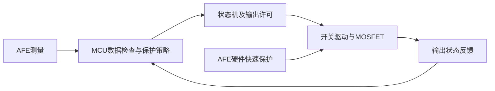

# 学习笔记与参考资料

更新：2026-10-17。这里只保存原理理解、资料用途和版本，不替代当前操作或实测记录。手册 PDF 继续留在被 Git 忽略的 /手册/；本文件可以提交到仓库。

导航：[手册索引与阅读顺序](#r11) · [原型与实际 BMS](#r19) · [Cortex-M3 寄存器](#r25)。参考仓库与硬件选型约束另见[项目规划](项目规划.md#p01)。外部资料版本为原核对日期的记录，整理文档时没有下载或替换 PDF。

<a id="r11"></a>

## 手册索引与阅读顺序

首次整理：2026-10-15，从官方手册资料目录13份PDF中选取9份，约41.8 MiB。2026-10-17补入原始硬件资料中的双USB核心板原理图；当前共10份、约42.26 MiB，已分别核对来源与副本SHA-256一致。

本页保存文件名、用途与版本信息，可随项目提交。PDF 及本地阅读说明保存在被忽略的“手册”目录中，GitHub 不包含这些文件；更换电脑后需从原资料包重新准备。

### 来源与存放位置

来源：

```text
D:\嵌入式学习\野火STM32F103ZET6核心板双USB款\野火STM32F103ZET6核心板双USB款_20240727\1-硬件资料_参考资料_规格手册\参考资料\STM32F1官方手册资料
```

新增原理图来源为同一资料包的“1-硬件资料_参考资料_规格手册/原理图_尺寸图_封装库_IO表格”，不属于上面的13份官方手册目录。

项目内存放方式：

```text
手册/
├─ README.md
├─ 01_芯片与板卡/       6 份 PDF
├─ 02_内核与实时系统/   3 份 PDF
└─ 03_定时器/           1 份 PDF
```

在本机打开手册/README.md，可以点击各文件链接。文件名和 PDF 正文均未修改，原来源文件仍保留。

### 已复制的资料

版本信息取自 PDF 封面或说明页，页数指 PDF 文件的实际页数，不等同于正文印刷页码。

| 本地分类 | 文件名 | 页数 | 本地版本 | 项目用途 |
| --- | --- | --- | --- | --- |
| 01_芯片与板卡 | `[野火]STM32F103ZET6核心板_双USB款_规格书V1.0.1.pdf` | 13 | V1.0.1，2024-06 | 优先看：板上供电、两种 USB 接口、SWD、LED 和 BOOT 跳帽 |
| 01_芯片与板卡 | `[野火]STM32F103ZET6核心板双USB款原理图.pdf` | 7 | 各页版本不同；LED所在第6页为V2.0、2023-11-04 | 核对LED有效电平、限流电阻、USB、跳帽及板载器件连接 |
| 01_芯片与板卡 | `2-STM32F103xCDE_数据手册-中文.pdf` | 87 | 对应英文 Rev 5，2009-03 | 核对 F103xE 的资源、LQFP144 引脚和电气条件，中文辅助阅读 |
| 01_芯片与板卡 | `2-STM32F103xCDE_数据手册-英文.pdf` | 123 | Doc ID 14611 Rev 7，2009-09 | 匹配 F103ZE 系列的数据手册，对照英文引脚与参数 |
| 01_芯片与板卡 | `1-STM32F10x-中文参考手册.pdf` | 754 | RM0008 中文译本，对应英文 Rev 10 | 学习 RCC、GPIO、EXTI、USART、ADC、DMA、I²C、CAN、定时器和看门狗 |
| 01_芯片与板卡 | `1-STM32F10x-英文参考手册.pdf` | 1128 | RM0008 Rev 15，2014-06 | 核对外设工作流程、寄存器位和限制，与中文版对照 |
| 02_内核与实时系统 | `STM32F10xxx Cortex-M3编程手册-英文版-PM0056-Rev6.pdf` | 156 | PM0056 Rev 6，2017-12 | 中断、异常、NVIC、SysTick、栈与内核寄存器；用于理解 FreeRTOS |
| 02_内核与实时系统 | `Cortex-M for Beginners - 2017_CN_v3.pdf` | 26 | Arm 入门白皮书，2017-03 | 快速建立 Cortex-M 家族、内核和 MCU 的概念 |
| 02_内核与实时系统 | `CM3权威指南CnR2.pdf` | 322 | 中文讲解资料；封面未标明对应的 ST 文档版本 | 按需理解 Cortex-M3、中断和异常流程，以官方手册核对细节 |
| 03_定时器 | `DM00042534_ZHV2_定时器应用笔记.pdf` | 33 | AN4013 中文第 2 版，2012-10 | 定时器时钟、时基、周期事件、PWM 和同步；只使用适用 F103ZE 的内容 |

野火规格书的 PDF 属性标题与实际封面不一致，本次以实际封面、正文和型号判断，没有修改其元数据。数据手册英文副本的属性也带有第三方站点名称，因此不能仅凭 PDF 属性认定来源版本。

### 本次暂不复制的资料

| 文件 | 原因 |
| --- | --- |
| 3-STM32F103x8数据手册.pdf | 对应 F103x8/xB，和项目 F103ZET6 的资源及封装选项不同 |
| STM8和STM32产品选型手册.pdf | 用于跨产品选型，当前型号已确定 |
| STM32F10xxx闪存编程参考手册.pdf | 本地为旧 PM0042 译本；第一版没有 IAP 或自定义 Bootloader，后续再查适配型号的 Flash 手册 |
| STM32系统存储器启动模式.pdf | AN2606 主要用于芯片系统 ROM 自举下载；当前先走 SWD，后续需要时再查 |

来源中的“更多官方文档下载方式.txt”仅为下载入口说明，本次也未复制。

### 按实施阶段查阅

| 阶段 | 优先资料 | 需要解决的问题 |
| --- | --- | --- |
| 初次上电与下载 | 野火规格书、数据手册 | 供电、两种 USB 接口、SWD、BOOT 跳帽、目标封装 |
| GPIO、UART、中断 | 野火双USB原理图；RM0008的RCC、GPIO/AFIO、USART、EXTI；PM0056的NVIC | 时钟、复用、串口收发与中断流程 |
| ADC 与 DMA | 数据手册、RM0008 的 ADC/DMA/RCC | 模拟输入引脚、参考电压、采样时钟、转换与搬运 |
| 定时采样 | RM0008 定时器章节、AN4013 | 时钟来源、分频、重装载、触发与周期 |
| I²C 与 CAN | RM0008 的 I²C、bxCAN | 地址、时序、收发、过滤器与中断 |
| FreeRTOS | PM0056，配合后续 FreeRTOS 文档 | 中断优先级、异常、SysTick、栈和上下文 |
| 看门狗与故障处理 | RM0008 的 IWDG、复位相关章节 | 超时复位与启动后的状态处理 |

不用从第一页通读所有资料。每一步围绕实际问题找章节、结合代码验证，并记录实际结果。

### 版本与适用性

本地中文 RM0008 对应英文 Rev 10，英文副本是 Rev 15；本地中文数据手册对应 Rev 5，英文副本为 Doc ID 14611 Rev 7。中英文不是同一版本，章节和页码可能不同。

核对时发现 [ST 当前 RM0008 英文文档](https://www.st.com/resource/en/reference_manual/cd00171190-stm32f101-103-105-107-stm32f100-series-armbased-32bit-mcus-stmicroelectronics.pdf) 为 Rev 21。本地资料作为学习副本保留；实际电气参数、工作条件及寄存器细节应结合目标芯片与官网对应资料核对，本次未额外下载或替换这些 PDF。

[STM32F103 官方文档目录](https://www.st.com/en/microcontrollers-microprocessors/stm32f103/documentation.html) 列有大容量器件的数据手册 DS5792，以及适用 STM32F101xC/D/E、STM32F103xC/D/E 的勘误 ES0340。当前来源目录没有这份勘误，后续外设验证时再结合实际芯片修订号核对；不能把中容量器件的 ES096 直接用于本项目。

RM0008 与 AN4013 覆盖多个系列或容量等级，不是其中每一个外设、通道和功能都属于 F103ZE。野火规格书对应双 USB 款 V1.0.1，收到硬件后仍需核对实物 PCB 和接线。上述是资料适用性说明，不是已经发生或解决的上板故障。

2026-10-17串口基础准备使用双USB原理图第5页J6跳帽、第7页CH340C与ISP电路，以及规格书2.4.12～2.4.13。PA9接板载桥接器RXD，PA10接TXD；DTR/RTS另连自动启动电路，不能把它们当作本步串口数据线。教程见[USART1固定文本发送](开发步骤.md#s27)。

2026-10-17学习CPU寄存器时核对[ST当前PM0056](https://www.st.com/resource/en/programming_manual/pm0056-stm32f10xxx20xxx21xxxl1xxxx-cortexm3-programming-manual-stmicroelectronics.pdf)为Rev7（2024-12）；本地副本仍为Rev6（2017-12）。本次使用第2.1.1～2.1.3节核对模式、栈和内核寄存器，相关定义相符，未下载、替换或修改本地PDF。结合实际截图的解释见[寄存器窗口笔记](学习笔记与参考资料.md#r25)。

### 后续硬件代码如何参考

用户确认这些资料作为后续硬件代码的参考。每个硬件步骤按照实际问题查阅，并说明所用文件、版本及章节：

1. 用野火规格书核对板卡接口、供电、跳帽与实物 PCB；涉及具体网络和器件时还需查看板卡原理图。
2. 用匹配 F103ZE、LQFP144 的数据手册核对引脚功能和电气条件。
3. 用 RM0008 核对时钟、外设工作模式、初始化顺序与寄存器，再对照当前 HAL 实现。
4. 涉及中断、SysTick、异常与实时系统时，用 PM0056 核对内核行为，并结合后续 FreeRTOS 版本与接口资料。
5. 记录关键配置的来源、推导过程和实际验证结果；手册版本不一致或涉及限制时，再查对应官网版本与芯片勘误。

手册用于理解硬件行为，不能代替实际接线和运行验证。保护与状态机的电脑端验证、板上外设验证和未来的实际负载闭环应分别记录，不能互相替代。

### Git 忽略与验证

根目录 .gitignore 已加入：

```gitignore
# Local reference manuals; keep this directory out of Git.
/手册/
```

这条规则忽略根目录的“手册”文件夹及所有子目录，也覆盖以后加入的 PDF。源码、测试和本页索引仍可提交；没有全局忽略所有 PDF，以便今后按需保存项目自己的测试报告。

首次复制前已确认手册目录中没有已跟踪文件，9份PDF逐一验证被忽略。新增双USB原理图也已通过git check-ignore验证；当前10份PDF都在/手册/忽略规则范围内，不会被正常git add .暂存。用户可自行复查：

```powershell
git check-ignore -v -- "手册/01_芯片与板卡/1-STM32F10x-中文参考手册.pdf"
git ls-files -- 手册
git status --short --untracked-files=all -- 手册
```

第一条应指向 .gitignore 的 /手册/ 规则；后两条应无文件输出。本次助手未执行暂存、提交或推送，也未改动项目代码。

<a id="r19"></a>

## 原型与实际 BMS 的关系

日期：2026-10-16。用途：说明当前软件骨架与实际电池管理设计的对应关系，供复盘和面试准备。本文没有新增项目功能，也没有改变已确定的硬件采购方向。

### 核心流程相通

对于采用MCU的电池管理系统，可以按“取得测量→判断数据是否可靠→保护决策→状态转换→输出控制及反馈”理解控制主线。这是结合本项目和厂商架构作出的概括，具体模块、调度周期和状态划分由产品决定，不是全行业统一的软件模板。

当前Bms_ControllerStep()已经把正常保护、活动故障、恢复许可和状态机连接起来，体现了保护优先、独立时间戳、故障累计、恢复回差、稳定时间和命令门控。十组电脑测试及Keil构建通过；load_enabled仍只是软件许可，尚未驱动或验证真实负载。

### 重要差别一：硬件保护与软件管理并行

计划中的BQ76920本身带过压、欠压、放电过流和放电短路等硬件保护，以及对主控的告警接口；主控通过I²C访问测量值并实现管理功能。因此后续接入AFE时，既要读取测量，也要处理其保护状态和告警。[TI BQ76920](https://www.ti.com/product/BQ76920)

以AFE＋MCU＋MOSFET电池包为例，可按如下关系理解；该图是结构解释，具体接线必须依据所选模块原理图：



软件周期检查不能替代快速短路保护。反过来，硬件保护被触发后，主控也不能仅因软件许可变为1就强行绕过它。项目后续需验证软件请求、AFE保护状态和实际输出之间的关系。

也存在无需MCU控制即可完成保护与均衡的专用器件，例如BQ77915。因此不能把“所有电池保护板都运行这四状态机或FreeRTOS”当作事实。[TI BQ77915](https://www.ti.com/product/BQ77915)

### 重要差别二：故障动作及恢复策略按类型设计

当前原型把检查发现的故障统一锁定，满足恢复条件后通过CLEAR回到待机，再发START运行。这样方便验证优先级与清除行为，是本项目的明确策略。

实际器件可以分别控制充电和放电开关，并为不同保护设置恢复行为。例如BQ76952支持可配置保护、可选自主恢复及不同低功耗模式，其技术手册还区分主要保护与永久故障。[TI BQ76952](https://www.ti.com/product/BQ76952)、[BQ76952技术参考手册](https://www.ti.com/document-viewer/lit/html/SLUUBY2)

据此，设计产品时需要逐项回答：故障禁止充电还是放电、是否需要锁定、能否自动恢复、需要何种外部条件。不能把本项目的统一CLEAR方式当作所有BMS的固定规则；当前软件参数与2秒恢复时间也不是通用电池参数。

### 重要差别三：高压车载系统增加高压控制及诊断

NXP高压BMS参考平台区分电芯监测单元CMU、管理单元BMU和电池接线盒BJB；BJB包含电流、包级高压及电池对车身绝缘监测。其BMU参考板还具有接触器驱动、预充控制接口、热管理输出、互锁及唤醒功能。[NXP高压BMS架构指南](https://www.nxp.com/document/guide/high-voltage-bms-reference-designs:GS-RD-HVBMSCTBUN)、[NXP RD-K344BMU](https://www.nxp.com/design/design-center/development-boards-and-designs/RD-K344BMU)

这些是高压系统的扩展例子，不代表小型低压电池包都必须采用同样架构。状态机可增加或分解预充、充电、休眠、唤醒等状态；具体是一个状态机还是多个协作状态机，要按系统职责设计。

例如在高压产品中，进入允许运行之前，还要按设计完成预充和相关反馈确认。软件置位允许输出与实际接触器已经正确动作是两件事，需通过测量和诊断确认。

### 当前求职项目的定位

目前完成的是电池监测与保护控制的软件骨架和电脑测试。还需通过实际外设、采样有效性、负载控制、通信、任务调度及故障注入来补齐演示闭环；SOC、均衡、Bootloader等仍按既定计划放在后续。

面试时可据实描述：“实现了采样数据格式、保护与故障汇总、四状态机、恢复回差与稳定计时，并用构造数据完成电脑端控制链测试。”当前另外完成了单路 ADC 输入及周期串口显示；真实电池采样、控制器上板闭环与负载控制尚未验证。

本次资料中的BQ76952、BQ77915和NXP平台仅作架构说明，不构成新采购建议，也不表示修改STM32F103＋BQ76920的既定项目方向。

<a id="r25"></a>

## Cortex-M3 寄存器窗口

日期：2026-10-17。用户确认main入口断点、单步与复位复测均成功，并询问Keil左侧寄存器窗口的含义。本页结合实际截图解释，不新增代码或修改调试配置。

### 窗口里是什么

Core和System主要展示Cortex-M3内核寄存器；Banked展示两套栈指针；Internal展示处理器模式及调试状态。States、Sec等包含调试器根据硬件计数整理的显示值，并非每一行都是独立的CPU通用寄存器。

通用寄存器是CPU内部少量、快速的32位存储位置，用于保存运算数据、指针和临时结果。它们与板上SRAM的物理位置不同；寄存器里可以存放指向SRAM的地址。

这些值是CPU暂停时的快照，继续运行后可能变化。一个十六进制数本身不能证明是指针，具体用途需要结合当前机器指令、调用约定和符号信息判断。

### Core：先看PC、SP和LR

| 名称 | 截图数值或范围 | 作用 |
| --- | --- | --- |
| R0～R12 | 如R0为0x20000070 | 通用寄存器，用于数据、地址与编译器临时结果 |
| R13 / SP | 0x20000670 | 当前使用的栈指针 |
| R14 / LR | 0x080001BB | 保存函数或异常返回信息；当前数值处于Flash代码地址附近 |
| R15 / PC | 0x0800093C | 调试器显示的当前程序指令位置 |
| xPSR | 0x21000000 | 运算标志、当前异常编号和Thumb执行状态的组合 |

按常见Arm调用约定，普通32位整数或指针参数常使用R0～R3，普通32位返回值常使用R0。但复杂参数和返回类型可能有其他规则，也不能认为某个C变量一直对应固定寄存器。

当前项目Flash范围为0x08000000～0x0807FFFF，SRAM范围为0x20000000～0x2000FFFF。因此PC位于Flash，SP位于SRAM；R0的数值落在SRAM地址范围，但未结合当前指令时不把它认定为某个具体变量。

#### 本次PC能确认什么

本次生成的bms_bringup.map列出：

```text
i.main           0x0800093c
main             0x0800093d   Thumb Code
__initial_sp     0x20000670
Stack_Mem        0x20000270   Data 1024
```

截图PC为0x0800093C，正好是main代码段起始位置，支持当前暂停在main入口的结论。

MAP中main函数符号的最低位为1，用于表示Thumb函数入口；实际指令地址按半字对齐，从0x0800093C开始。普通函数调用中LR的最低位也用于Thumb状态，因此0x080001BB这样的奇数返回表示值是正常的，不能直接当成未对齐错误。异常返回时LR还可能保存EXC_RETURN编码，本次截图不是该编码形式。

这些地址只对应本次构建，新增代码、调整优化或链接顺序后可能变化。以后定位问题应查看对应版本的MAP及反汇编。

#### 栈指针具体指向哪里

栈是RAM中为函数调用和临时保存分配的区域，常用来保存返回信息、寄存器及需要放入内存的局部数据。并不是每个局部变量都一定放在栈上。

Cortex-M3使用向低地址增长的栈：压入数据时通常先减小SP，再写入；释放栈空间时SP增大。单步跨过函数后，函数可能已释放自己的栈空间，所以SP可以回到调用前的值。

本项目启动文件Stack_Size为0x400，即1024字节；MAP分配的Stack_Mem为0x20000270，初始栈顶__initial_sp为0x20000670。截图SP与初始栈顶一致，这是具体链接布局产生的值，不要求栈必须放在64 KiB SRAM的最后一个地址。

芯片SRAM总量、启动文件分配的栈大小、上一课下载算法的RAM工作区，是不同概念。

### xPSR：为什么数值不是零

xPSR合并了APSR、IPSR和EPSR相关状态：

| 部分 | 主要内容 |
| --- | --- |
| APSR | 运算产生的N、Z、C、V等条件标志 |
| IPSR | 当前异常编号，0表示Thread模式 |
| EPSR | Thumb状态及指令执行相关状态 |

对于截图0x21000000：

- bit24的T为1，表示Thumb执行状态，符合Cortex-M3正常执行要求。
- bit29的C为1，表示最近一次更新该标志的运算产生了进位，或减法没有借位；具体是哪条指令需查看反汇编。
- IPSR低9位为0，表示当前没有处于异常处理函数，和窗口Mode为Thread一致。

标志位反映特定指令产生的状态，不是统一的“0正常、非0错误”标记。

### Banked：MSP与PSP

| 名称 | 截图 | 含义 |
| --- | --- | --- |
| MSP | 0x20000670 | 主栈指针，复位后的默认栈指针 |
| PSP | 0x00000000 | 进程栈指针，当前未作为活动栈 |
| SP | 与MSP相等 | 当前选择使用MSP |

Banked表示R13/SP有MSP与PSP两套可选存储。当前裸机程序使用MSP，PSP还未投入使用，不能仅凭PSP为0判断异常。

后续采用常规Cortex-M3 FreeRTOS端口时，任务通常使用PSP，中断处理使用MSP，任务切换保存和恢复各任务执行上下文。这里仅解释后续联系，当前工程没有启动FreeRTOS。

### System：中断屏蔽与CONTROL

| 名称 | 截图值 | 含义 |
| --- | --- | --- |
| BASEPRI | 0x00 | 没有通过优先级门槛屏蔽可配置异常 |
| PRIMASK | 0 | 没有通过PRIMASK统一屏蔽可配置优先级异常 |
| FAULTMASK | 0 | 没有通过FAULTMASK屏蔽异常 |
| CONTROL | 0x00 | 当前Thread模式为特权级，并选择MSP |

更具体地：

- PRIMASK设为1会屏蔽可配置优先级异常，但不屏蔽NMI和HardFault。
- FAULTMASK设为1会屏蔽除NMI之外的异常，包括HardFault。它是屏蔽控制寄存器，不是故障发生标志。
- BASEPRI非零时设置屏蔽门槛，同等或更低优先级的可屏蔽异常不能激活；优先级数值越大，优先级越低。当前为0，未启用该门槛。
- CONTROL bit0为0表示特权级，bit1为0表示Thread模式选择MSP。

这几个屏蔽寄存器为0，不表示所有外设中断都已开启；外设、NVIC使能和其他中断条件仍要配置。

### Internal：模式与计时显示

| 字段 | 截图 | 解释 |
| --- | --- | --- |
| Mode | Thread | 当前执行普通应用程序；处理异常时为Handler |
| Privilege | Privileged | 当前执行处于特权级 |
| Stack | MSP | 当前活动栈为主栈 |
| States | 993 | Cortex-M3实物调试中，Keil依据DWT_CYCCNT显示的周期计数 |
| Sec | 0.00009930 | 根据计数和调试器时钟基准折算的秒数 |

Thread是处理器模式，裸机main()也在该模式运行，不能据此认为FreeRTOS任务已经启动。

[Keil官方寄存器窗口说明](https://www.keil.com/support/man/docs/uv4/uv4_db_dbg_cpuregs.asp)指出，Cortex-M3目标的States来自DWT周期计数，Sec基于同一信息。

本次截图有一个后续计时前应核对的显示差异：

```text
993 / 0.00009930 = 10000000
```

由这组历史截图显示值推算，Sec采用了相当于10 MHz的换算基准，当时调试配置字符串也含-TC10000000，而当时固件使用HSI 8 MHz。由此推断调试器时间基准需要与实际内核时钟核对，不能把该Sec显示直接作为固件运行时间实测，也不能据此宣称CPU实际工作在10 MHz。后续固件已切换到HSE/PLL 72 MHz，应按新配置核对调试器的Core Clock；SWD通信时钟另行设置。

本轮不修改Trace或固件时钟；后续使用调试器计时显示时再核对Settings中的Core Clock配置。Debug通信时钟（上一课的4 MHz）、MCU内核时钟、调试器用于换算时间的基准分别处理。

### 可做的小观察

不改代码，在main入口暂停后记录PC，再按F10观察PC是否变化。C语言一行可能对应多条机器指令及函数调用，因此不要求每次只加2或4。

同时观察SP、LR和R0～R3。F10跨过函数后SP可能恢复原值，R0可能成为返回值或临时值，这些都是理解调用过程的线索，不作为新功能验收要求。

### 资料与本次状态

主要本地资料为PM0056 Rev6（2017-12）第2.1.1～2.1.3节，PDF第13～22页；对应官网当前为[PM0056 Rev7（2024-12）](https://www.st.com/resource/en/programming_manual/pm0056-stm32f10xxx20xxx21xxxl1xxxx-cortexm3-programming-manual-stmicroelectronics.pdf)，本次核对的核心定义相符。本地PDF未替换，仍由.gitignore忽略。

用户已确认断点、单步及复位复测通过，截图PC/SP与当时MAP入口/初始栈顶一致。截图之后已完成LED、UART和单路ADC基础实验；实际负载输出及BMS控制器接入main()仍未完成。提交操作统一见[每步Git收尾](开发步骤.md#git-routine)，由用户执行。
